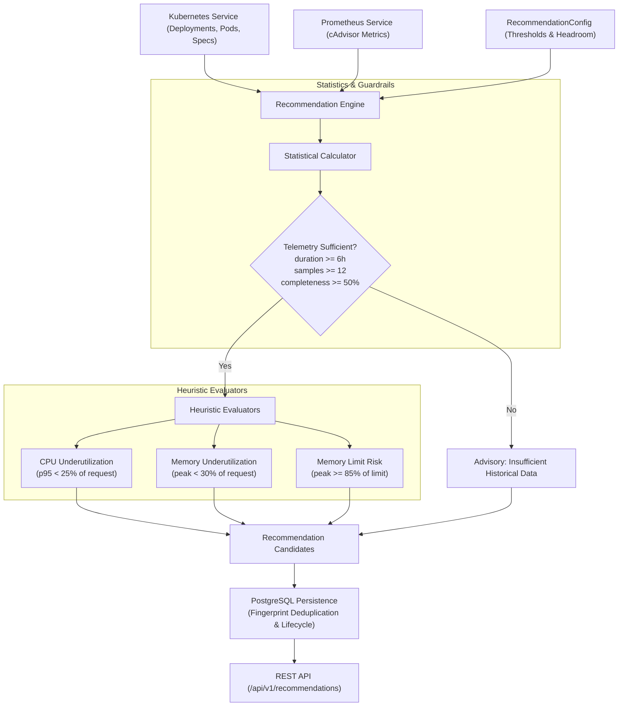

# KubeWatch — Resource Recommendation Engine Specification & Calculations

This document details the mathematical formulas, threshold configurations, heuristics, safety guardrails, test procedures, and limitations of the KubeWatch Resource Recommendation Engine.

---

## 1. Engine Overview & Architecture

The KubeWatch recommendation engine evaluates container resource efficiency across Kubernetes workloads (`Deployments`, `StatefulSets`, `DaemonSets`, `Pods`) by correlating Kubernetes API specifications against verified Prometheus historical metrics (`cAdvisor`).



### Safety Principles
1. **Read-Only Operation**: The engine generates advisory recommendations only. It never automatically modifies Kubernetes manifests or live clusters.
2. **Missing Metrics are Not Zero**: When telemetry is absent or Prometheus is unreachable, missing data points are never coerced to zero. Workloads with missing or insufficient telemetry receive an explicit `insufficient_historical_data` advisory notice.
3. **No Fictional Cost Savings**: Percentage reduction in resource requests increases node allocatable scheduling capacity; cloud cost reduction is conditional upon downscaling worker node instances. The engine explicitly communicates allocatable capacity freed rather than claiming 1:1 monetary bill reduction.

---

## 2. Statistical Calculations

### 2.1 Observation Duration & Data Completeness
Let:
- $T_{\text{start}}$ and $T_{\text{end}}$ be the UTC timestamps bounding the evaluation window.
- $D = T_{\text{end}} - T_{\text{start}}$ be the duration in seconds ($D_{\text{hours}} = \frac{D}{3600}$).
- $S_{\text{step}}$ be the Prometheus sampling step interval (default: $300\text{ s} = 5\text{ min}$).
- $N_{\text{collected}}$ be the number of valid scalar samples collected from Prometheus.

The expected sample count is:
$$N_{\text{expected}} = \max\left(1, \left\lfloor \frac{D}{S_{\text{step}}} \right\rfloor\right)$$

The telemetry completeness ratio is:
$$R_{\text{completeness}} = \min\left(1.0, \frac{N_{\text{collected}}}{N_{\text{expected}}}\right)$$

### 2.2 Data Sufficiency Guardrails
A workload's historical metrics are certified as statistically sufficient for sizing if and only if:
1. $D_{\text{hours}} \ge \text{min\_observation\_hours}$ (default: $6.0\text{ hours}$)
2. $N_{\text{collected}} \ge \text{min\_samples\_for\_evaluation}$ (default: $12\text{ samples}$)
3. $R_{\text{completeness}} \ge \text{min\_completeness\_ratio}$ (default: $0.50 = 50\%$)

If any condition fails, sizing is suppressed and an `insufficient_historical_data` advisory is emitted.

### 2.3 Percentile, Average, and Peak
For a sorted sequence of observed metric values $x_0 \le x_1 \le \dots \le x_{N-1}$:
- **Average Usage**:
  $$\bar{x} = \frac{1}{N} \sum_{i=0}^{N-1} x_i$$
- **Peak Usage**:
  $$x_{\text{peak}} = \max(x_0, x_1, \dots, x_{N-1})$$
- **p95 Percentile**:
  Computed using linear interpolation only when $N \ge \text{min\_samples\_for\_p95}$ (default: $20$).
  Let index $k = 0.95 \times (N - 1)$, with integer lower index $i = \lfloor k \rfloor$, upper index $j = \min(N - 1, i + 1)$, and weight $w = k - i$:
  $$x_{p95} = (1 - w) \cdot x_i + w \cdot x_j$$
  When $N < 20$, $x_{p95}$ is reported as `null` (`None`) to prevent statistical noise.

---

## 3. Recommendation Heuristics & Sizing Formulas

### 3.1 Persistent CPU Underutilization (`cpu_underutilization`)
- **Metric**: `container_cpu_usage_cores`
- **Condition**: Workload has a configured CPU request $C_{\text{request\_m}}$ (in millicores).
  The evaluated utilization is:
  $$U_{\text{cpu}} = \frac{x_{p95\text{\_m}}}{C_{\text{request\_m}}} \times 100\%$$
  (Uses peak if sample count for p95 was suppressed).
- **Trigger**: $U_{\text{cpu}} < \text{cpu\_underutilization\_threshold\_percent}$ (default: $25.0\%$).
- **Suggested Target Formula**:
  $$C_{\text{target\_m}} = \max\left(\text{min\_cpu\_floor\_millicores}, \left\lfloor x_{p95\text{\_m}} \times H_{\text{cpu}} \right\rfloor\right)$$
  where $H_{\text{cpu}} = 1.25$ (25% safety headroom) and floor $= 50\text{m}$.
- **Allocatable Capacity Freed**:
  $$\Delta C = C_{\text{request\_m}} - C_{\text{target\_m}}$$

### 3.2 Persistent Memory Underutilization (`memory_underutilization`)
- **Metric**: `container_memory_usage_bytes` (working set)
- **Condition**: Workload has a configured memory request $M_{\text{request\_bytes}}$.
  The evaluated utilization is:
  $$U_{\text{mem}} = \frac{x_{\text{peak\_bytes}}}{M_{\text{request\_bytes}}} \times 100\%$$
- **Trigger**: $U_{\text{mem}} < \text{memory\_underutilization\_threshold\_percent}$ (default: $30.0\%$).
- **Suggested Target Formula**:
  $$M_{\text{target\_bytes}} = \max\left(\text{min\_memory\_floor\_bytes}, \left\lfloor x_{\text{peak\_bytes}} \times H_{\text{mem}} \right\rfloor\right)$$
  where $H_{\text{mem}} = 1.25$ (25% safety buffer above peak working set) and floor $= 64\text{ MiB}$.
- **Allocatable Capacity Freed**:
  $$\Delta M = M_{\text{request\_bytes}} - M_{\text{target\_bytes}}$$

### 3.3 High Memory Limit Risk (`high_memory_limit_utilization`)
- **Metric**: `container_memory_usage_bytes`
- **Condition**: Workload has a configured memory limit $M_{\text{limit\_bytes}}$.
  The evaluated limit utilization is:
  $$U_{\text{limit}} = \frac{x_{\text{peak\_bytes}}}{M_{\text{limit\_bytes}}} \times 100\%$$
- **Trigger**: $U_{\text{limit}} \ge \text{memory\_limit\_risk\_threshold\_percent}$ (default: $85.0\%$).
- **Suggested Target Limit**:
  $$M_{\text{limit\_target}} = \left\lfloor x_{\text{peak\_bytes}} \times H_{\text{mem}} \right\rfloor$$
  Increases the container limit to provide headroom and prevent kernel OOM termination.

### 3.4 Insufficient Historical Data Advisory (`insufficient_historical_data`)
- **Condition**: Workload container has configured requests or limits, but telemetry history has $N = 0$, $D_{\text{hours}} < 6.0\text{h}$, $N < 12$, or $R_{\text{completeness}} < 50\%$.
- **Action**: Informs the cluster operator of the observation status and prevents premature sizing decisions.

---

## 4. Configurable Engine Parameters

| Parameter | Type | Default | Description |
|---|---|---|---|
| `observation_window_hours` | int | `24` | Historical observation window lookback in hours |
| `step_seconds` | int | `300` | Prometheus sampling step (5 minutes) |
| `min_observation_hours` | float | `6.0` | Minimum observation history required before sizing |
| `min_samples_for_evaluation` | int | `12` | Minimum samples required |
| `min_samples_for_p95` | int | `20` | Minimum sample count for p95 computation |
| `min_completeness_ratio` | float | `0.50` | Minimum sample completeness ratio (50%) |
| `cpu_underutilization_threshold_percent` | float | `25.0` | Sizing trigger threshold for CPU |
| `memory_underutilization_threshold_percent` | float | `30.0` | Sizing trigger threshold for Memory |
| `memory_limit_risk_threshold_percent` | float | `85.0` | Risk trigger threshold for Memory limit |
| `cpu_headroom_factor` | float | `1.25` | Headroom multiplier applied to CPU usage |
| `memory_headroom_factor` | float | `1.25` | Headroom multiplier applied to Memory usage |
| `min_cpu_floor_millicores` | int | `50` | Minimum allowable target CPU request (50m) |
| `min_memory_floor_bytes` | int | `67108864` | Minimum allowable target memory request (64 MiB) |

---

## 5. Examples Based on Labelled Test Data

### Example 1: Persistent CPU Underutilization
* **Workload**: `Deployment/default/checkout-service` (container `checkout`)
* **Current Config**: `cpu_request: 1000m`
* **Telemetry**: 200 samples over 24h, avg: 80m, p95: 100m, peak: 150m (10.0% utilization at p95)
* **Calculated Target**: $100\text{m} \times 1.25 = 125\text{m}$
* **Recommendation**:
  > Right-size CPU request from `1000m` to `125m` (includes 25% safety headroom above measured p95). Frees 875m of allocatable node CPU (87.5% reduction in request).
* **Cost Disclaimer**:
  > Reducing CPU requests increases pod scheduling density and frees node allocatable capacity; cloud billing reduction depends on whether overall cluster node count can be downscaled.

### Example 2: Persistent Memory Underutilization
* **Workload**: `Deployment/default/api-gateway` (container `gateway`)
* **Current Config**: `memory_request: 1Gi` (1024 MiB)
* **Telemetry**: 200 samples over 24h, avg: 150 MiB, peak: 200 MiB (19.5% utilization at peak)
* **Calculated Target**: $200\text{ MiB} \times 1.25 = 250\text{ MiB}$
* **Recommendation**:
  > Right-size memory request from `1Gi` to `250Mi` (includes 25% safety buffer above peak working set). Frees 774Mi of allocatable node memory (75.6% reduction in request).

### Example 3: Memory Limit Risk (OOMKill Prevention)
* **Workload**: `StatefulSet/database/postgres` (container `db`)
* **Current Config**: `memory_limit: 1000Mi`
* **Telemetry**: 50 samples over 12h, peak working set: 900 MiB (90.0% of limit)
* **Calculated Target Limit**: $900\text{ MiB} \times 1.25 = 1125\text{ MiB}$
* **Recommendation**:
  > Increase container memory limit from `1000Mi` to `1125Mi` to provide safety headroom and avoid container restart loops. Assumes high memory utilization is legitimate workload demand rather than an unbounded memory leak.

### Example 4: Insufficient Historical Observations
* **Workload**: `Deployment/jobs/queue-consumer` (container `worker`)
* **Current Config**: `cpu_request: 500m`
* **Telemetry**: 4 samples over 1.5 hours
* **Recommendation**:
  > Advisory: KubeWatch cannot safely produce resource sizing recommendations for this workload due to incomplete historical telemetry: Observation window (1.5h) is shorter than required minimum (6.0h). Allow the workload to run across a complete operational window (24h) before adjusting resource requests or limits.

---

## 6. How to Run the Test Suite

Execute the following commands from the repository root:

```powershell
# Run the recommendation engine test suite
backend\.venv\Scripts\pytest.exe backend\tests\test_recommendations.py -v

# Run the complete test suite across all modules
backend\.venv\Scripts\pytest.exe -c backend\pytest.ini -v

# Verify the frontend build
npm --prefix frontend run build
```

---

## 7. Limitations & Future Roadmap

1. **Seasonal / Cyclical Traffic**: The initial engine analyzes up to 24-hour windows. Workloads with weekly or monthly diurnal cycles (e.g. month-end payroll batch jobs) require longer Prometheus data retention or persistent downsampled metric tables.
2. **Horizontal Pod Autoscaling (HPA)**: When an HPA is actively scaling replica counts based on target CPU percentage, per-replica CPU usage remains near the target. Workloads managed by HPA should be sized based on base-load capacity rather than static peak reductions.
3. **Application Initialization Spikes**: Certain JVM or large runtimes exhibit high CPU during startup (class-loading, JIT compilation) followed by low steady-state consumption. The engine recommends setting appropriate startup probes and requests that accommodate initialization.

