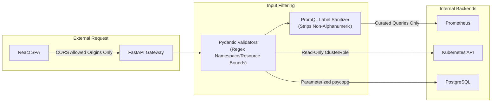

# KubeWatch — Security & Access Control Specification

This document details the security posture, isolation boundaries, credential protection mechanisms, PromQL injection mitigations, and Kubernetes Role-Based Access Control (RBAC) specifications for KubeWatch.

---

## 1. Security Verification Audit

An audit of the codebase was conducted across backend and frontend layers to verify core security requirements.

### 1.1 Secret Protection
* **Requirement**: The application must never retrieve or inspect Kubernetes Secret contents.
* **Audit Finding**: **CONFIRMED**
  - Zero calls exist to `list_namespaced_secret`, `read_namespaced_secret`, or any CoreV1 Secret endpoint.
  - The Kubernetes client facade (`backend/app/services/kubernetes_service.py`) explicitly restricts its core client usage to `Node`, `Pod`, `Namespace`, and `Event` resources.

### 1.2 Read-Only Cluster Operations
* **Requirement**: Monitoring functionality must never modify cluster resources, evict pods, or edit manifests automatically.
* **Audit Finding**: **CONFIRMED**
  - No mutating methods (`create_*`, `delete_*`, `patch_*`, `replace_*`, `post_*`) are called against the Kubernetes API.
  - Recommendations generated by the recommendation engine are purely advisory; users must review and apply changes externally.

### 1.3 Credential Isolation & Frontend Integrity
* **Requirement**: Credentials must never be exposed or compiled into the client-side bundle.
* **Audit Finding**: **CONFIRMED**
  - The frontend React application only reads `VITE_API_BASE_URL` (pointing to the local backend proxy).
  - Kubeconfig paths, cluster bearer tokens, database connection strings, and Prometheus URLs remain strictly on the backend host.
  - A comprehensive search of `frontend/src` for passwords, tokens, connection strings, or port references yielded zero credential leakage.

### 1.4 Version Control & Environment File Exclusion
* **Requirement**: Local `.env` files containing environment secrets must be excluded from Git tracking.
* **Audit Finding**: **CONFIRMED**
  - Root `.gitignore` explicitly ignores `.env`, `.env.local`, and `.env.*.local`.
  - Frontend `.gitignore` ignores `*.local`.
  - `git check-ignore -v backend/.env frontend/.env.local` verified that environment files are ignored.
  - `git status --ignored` confirmed that `backend/.env` and `frontend/.env.local` are untracked.

### 1.5 PromQL Injection Prevention
* **Requirement**: No arbitrary or unrestricted PromQL query endpoint may be exposed to clients.
* **Audit Finding**: **CONFIRMED**
  - The API does not accept arbitrary PromQL query strings.
  - Metrics are served exclusively through predefined templates in `CURATED_QUERIES`:
    - `node_cpu_usage_percent`
    - `node_memory_usage_percent`
    - `pod_cpu_usage_cores`
    - `pod_memory_usage_bytes`
    - `container_cpu_usage_cores`
    - `container_memory_usage_bytes`
  - Input parameters (`namespace`, `pod`, `node`) are sanitized via `_sanitize_label()`:
    ```python
    def _sanitize_label(value: str) -> str:
        if value == ".*":
            return value
        return "".join(c for c in value if c.isalnum() or c in "-_.")
    ```
    Any character that could break out of PromQL label matchers (such as quotes, braces, commas, slashes) is stripped.

### 1.6 Exception Sanitization & Error Leakage Prevention
* **Requirement**: Server-side exceptions must not leak sensitive connection credentials or internal tokens in HTTP responses.
* **Audit Finding**: **CONFIRMED**
  - Database error handling (`backend/app/db/session.py`): Logs full stack traces server-side while returning generic HTTP 500/503 envelopes (`"Database service is currently unreachable."`, `"A database error occurred while processing the request."`).
  - Kubernetes API errors (`backend/app/services/kubernetes_service.py`): Catches `ApiException` and extracts only `exc.reason` rather than returning raw HTTP headers or authorization bearer tokens.

---

## 2. In-Cluster RBAC Deployment Specification

When KubeWatch is deployed inside a Kubernetes cluster (`KUBERNETES_MODE=in_cluster`), it must operate under a dedicated `ServiceAccount` bounded by a least-privilege `ClusterRole`.

### 2.1 Least-Privilege RBAC Manifests

```yaml
---
apiVersion: v1
kind: ServiceAccount
metadata:
  name: kubewatch-sa
  namespace: kubewatch
  labels:
    app.kubernetes.io/name: kubewatch
    app.kubernetes.io/part-of: kubewatch

---
apiVersion: rbac.authorization.k8s.io/v1
kind: ClusterRole
metadata:
  name: kubewatch-viewer-role
  labels:
    app.kubernetes.io/name: kubewatch
    app.kubernetes.io/part-of: kubewatch
rules:
  # Core group: Cluster topology, workload pods, and scheduling events
  - apiGroups: [""]
    resources:
      - nodes
      - pods
      - namespaces
      - events
    verbs:
      - get
      - list

  # Apps group: Deployment replica health and rollout state
  - apiGroups: ["apps"]
    resources:
      - deployments
      - replicasets
    verbs:
      - get
      - list

---
apiVersion: rbac.authorization.k8s.io/v1
kind: ClusterRoleBinding
metadata:
  name: kubewatch-viewer-binding
  labels:
    app.kubernetes.io/name: kubewatch
    app.kubernetes.io/part-of: kubewatch
subjects:
  - kind: ServiceAccount
    name: kubewatch-sa
    namespace: kubewatch
roleRef:
  apiGroup: rbac.authorization.k8s.io/v1
  kind: ClusterRole
  name: kubewatch-viewer-role
```

### 2.2 Permissions Rationale

| API Group | Resources | Verbs | Justification |
|---|---|---|---|
| `""` (Core) | `nodes` | `get`, `list` | Inspects node status (`Ready`), capacity, allocatable CPU/RAM, and pressure conditions (`MemoryPressure`, `DiskPressure`). |
| `""` (Core) | `pods` | `get`, `list` | Evaluates pod phase, container restart counts, termination states (`OOMKilled`), and resource requests/limits. |
| `""` (Core) | `namespaces` | `get`, `list` | Populates namespace filters and validates requested namespaces. |
| `""` (Core) | `events` | `get`, `list` | Correlates pod scheduling failures (e.g. `FailedScheduling`) for pending pod diagnosis. |
| `apps` | `deployments` | `get`, `list` | Detects replica deficits between desired replicas and available replicas. |
| `apps` | `replicasets` | `get`, `list` | Correlates deployment revisions with underlying pod controllers. |

### 2.3 Explicitly Forbidden Resources
The `ClusterRole` strictly omits:
- `secrets`: Prevents access to application tokens, TLS certificates, and API keys.
- `configmaps`: Not required for monitoring cluster state.
- Mutating verbs (`create`, `update`, `patch`, `delete`, `deletecollection`): Guarantees the application cannot alter cluster workloads.

---

## 3. Defense-in-Depth Summary



1. **Network**: Backend CORS middleware only permits configured origins (`CORS_ORIGINS`).
2. **Input Validation**: Time ranges cannot exceed 168 hours; namespaces are restricted to Kubernetes RFC 1123 label format.
3. **Storage**: All database queries use SQLAlchemy parameterization; raw string interpolation in SQL is avoided.

